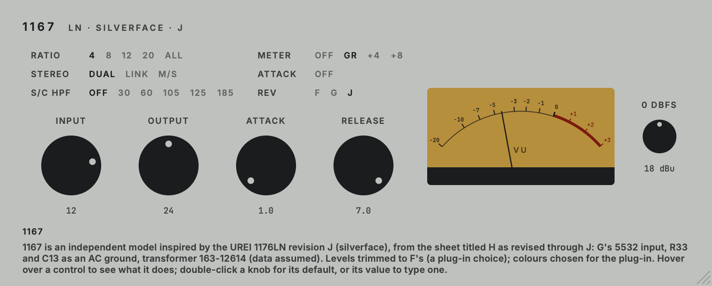

# 1167

Inspired by the UREI 1176LN, revisions F, G and J.<br>
Part of the codycodie legacy release collection. A reduced-circuit model of the original component
network: about 118x real time as a hosted stereo plug-in at 48 kHz on an Apple M3, with Dual, Link and
Mid/Side stereo modes.

1167 is a schematic-derived AU and VST3 compressor model. Its signal path, side chain, gain-reduction FET, discrete line amplifier, transformers, meter behaviour, and front-panel control laws follow the documented circuit of the selected revision rather than a conventional compressor transfer curve. The **Rev** row chooses revision F (the circuit of v0.2.x, the default), G or J.

Since v0.2.0 the plug-in runs a reduced-circuit engine, `urei1176::FastChannel`. It uses the same component values as the full circuit model. The linear blocks (input network, gain-reduction network, ratio ladder, side-chain amplifier, line amplifier and transformers) are solved exactly by the trapezoidal rule as small state-space systems, so they keep the bilinear response of the full solver at every sample rate. The gain-reduction FET (Q1), the gain-reduction amplifier's input and second-stage transistors (Q12 and Q14, solved as transistors), the CR3/CR4 rectifier and the control-voltage loop are solved per sample, and the loop still closes within the sample. The overload behaviour of the preamp and the line amplifier is a fitted approximation of the full circuit solver, not a circuit solution. The full solver, `urei1176::Channel`, stays in the source tree as the reference the fast engine is fitted and tested against.




The editor follows the selected revision's hardware: F and G share the black face (near-black panel, white legends, silver-capped knobs, cream VU), J the silver face (grey-silver panel, black knobs, amber VU). The colours are chosen for the plug-in after that hardware, not measured, and no logo or printed legend is drawn.

1167 is an independent product identity. It keeps the original parameter IDs, order and ranges of the 1176 model and appends parameters (`stereo`, `attackOff`, `sidechainFilter`, `model`), so existing 1176 automation and state data remain compatible. v0.3.0 changed only the Attack and Release defaults of a new instance; saved sessions keep their values. Its bundle identifier is `com.c0dypeng.legacy1167`.

## Downloads

Get the latest packages from the [1167 releases page](https://github.com/chijenpeng/1167/releases/latest). The macOS release contains Universal AU and VST3 bundles for Apple Silicon and Intel. The Windows release contains a native x64 VST3. macOS bundles are ad-hoc signed and are not notarized; the Windows plug-in is unsigned.

1167 has its own plug-in identity, so existing DAW instances continue to refer to the original 1176 plug-in and must be replaced manually. Sessions saved by v0.2.x load as revision F (Version F), with the S/C HPF off and their own Attack, Release and other values; they sound as before. Sessions saved by v0.1.0 load as Dual, with the Attack Off switch set from the old Attack value.

## Controls

- **Input** and **Output** use the hardware's attenuation markings. Both at 24 are approximately unity gain below the limiting threshold.
- **Attack** and **Release** run from 1 to 7, clockwise faster. A new instance starts with Attack at 1 (the slowest) and Release at 7 (the fastest); saved sessions keep their own values. The hover help gives the model's measured times next to the manual's figures: Attack 0.25 ms at 7 to 3.7 ms at 1 (time to 63 % of the reduction found 25 ms into a burst 10 dB over the threshold; the manual says 20 to 800 microseconds), Release 88 ms at 7 to 1.28 s at 1 (time to recover 63 % of a 6.7 dB reduction; the manual says 50 ms to 1.1 s).
- **Attack Off** (below the Meter row) switches limiting off while leaving the audio path active: it is the hardware's S9 (the Attack knob's OFF click), kept as a switch so the knob keeps its setting; the knob is dimmed while it is on.
- **Ratio** provides 4:1, 8:1, 12:1, 20:1, all-buttons-in, and no button selected.
- **Meter** switches between off, gain reduction, +4 VU, and +8 VU.
- **0 dBFS** sets the analogue calibration from 10 to 26 dBu.
- **Rev** (F, G, J; default F; the host calls the parameter Version, and its normalised values are F 0, G 0.5, J 1.0): the 1176 revision to model.
  - **F**: the circuit of v0.2.x, bit-identical with the S/C HPF off. Black face.
  - **G** (provenance: Circuit, with Approximation where the sheets are silent): the bridging-input revision. A 5532 receiver (10 k input impedance) and a 10 k Input pot replace the bridged-T pad and T1, with a 30.3 V supply, its own preamp and line-amp values, and an output transformer with one primary and R84 (1 k) across the secondary. Its Input dial reads as F's (Approximation: the sheets give no pot law). Black face.
  - **J** (provenance: Circuit, with Approximation): the sheet titled H as revised through J. It has G's 5532 input, supply and preamp, a line amp whose R33 (11 k) and C13 (100 uF) make an AC ground, so there is no high-frequency shelf, and output transformer 163-12614. No winding data exists for that transformer: F's data with both winding resistances doubled is used (Approximation). Two part values are ambiguous on the sheet (R33 and R20); the readings used give a maximum gain of 45.8 dB against the manual's 45 +-1 dB. Silver face.
  - **Level trims** (provenance: Custom, a plug-in choice; the hardware has none): at the same dials the circuit alone puts G's thresholds about 10 dB below F's and its gain about 5.5 dB higher. G and J therefore carry an input and an output trim (G: -10.2 dB and +4.97 dB; J: -10.2 dB and +4.21 dB), so that their thresholds and their gain at 24 / 24 match F's. UREI's own note says G's threshold is 6 dB lower; the circuit does not reproduce that.
  - **Switching** builds the new engine off the audio thread and crossfades to it over 20 ms, starting from the old engine's gain reduction, so changing revision while compressing does not jump in level.
  - Revision D is not included: there is no measured data for the transformer it uses and no printed class A bias.
- **S/C HPF** (OFF, 30, 60, 105, 125, 185 Hz; default OFF; provenance: Custom): a first-order (6 dB per octave) high-pass filter on the detector only; the audio you hear is not filtered. The higher the corner, the less low frequencies push the compressor. It is a plug-in addition: the 1176 has no such filter. It sits in front of the gain-reduction amplifier, inside the per-sample solve, so the compressor behaves as a feedback design with a filtered detector, in Dual and in Link; in M/S it acts on the mid and side detectors. Changing the choice glides over about 10 ms. OFF is exactly the unfiltered detector.
- **Stereo** (Dual, Link, M/S; mono tracks ignore it):
  - **Dual**: each channel has its own complete engine and side chain.
  - **Link** (provenance: Derived): the 1176SA tie of the two units' control nodes. Both rectifiers charge one shared control node (both C27s, release and bias returns in parallel, each gain cell drawing from it), solved jointly inside every sample; both channels get the same gain reduction, driven by whichever side is louder. With one side driven the attack is about twice as slow (the node has twice the capacitance) and the release is unchanged. The real adapter's floating offset source, which nulls two units' idle difference, is not modelled: its values are unverified, and two identical units have none to null. With identical L and R, Link is Dual.
  - **M/S**: the two units see M = (L + R) / 2 and S = (L - R) / 2 and the output is L = M + S, R = M - S. A mono-compatible source sounds as in Dual.

  Switching mode while playing does not click: Link glides the two units' control voltages together over about 15 ms, M/S morphs its matrix in or out over 10 ms.

## Limits

- The overload behaviour of the preamp and the line amplifier is a fitted approximation of the full circuit solver, not a circuit solution. Known deviations from the full solver are listed in the release notes and in [`docs/research/urei-1176.md`](docs/research/urei-1176.md).
- On G and J, at 4:1 with a very hot input (+22 to +26 dBu at the plug-in's input), the reference circuit has -53 to -61 dBc of third harmonic from Q1's gate junctions that the fast engine does not produce. On F the line amplifier clips first at those levels, and the fast engine matches the reference there.
- J's output transformer has no winding data (Approximation), and two of its part values are ambiguous on the sheet.
- The level trims, the S/C HPF and the panel colours are choices made for this plug-in, not hardware.
- CPU (Apple M3, hosted stereo VST3, 48 kHz, 512-sample buffer): about 118x real time for F and about 112x for G; J was not timed on the wall clock and is about the same as G (same instruction count). Dual and M/S cost about the same; Link about 1.1 times Dual.

## Build

The project requires CMake 3.22 or later and a C++17 compiler. For AU and VST3 builds, use macOS 11 or later; the Windows VST3 release uses native x64 MSVC from Visual Studio 2022. It uses JUCE 8.0.9. Put a local checkout at `third_party/JUCE` to avoid a fetch; otherwise CMake downloads that tagged release while configuring.

```sh
cmake -S . -B build -G Ninja -DCMAKE_BUILD_TYPE=Release
cmake --build build -j2
ctest --test-dir build --output-on-failure
```

On Windows, configure with `cmake -S . -B build -G "Visual Studio 17 2022" -A x64 -DCOPY_PLUGIN_AFTER_BUILD=OFF`, then build with `cmake --build build --config Release --parallel 2` and test with `ctest --test-dir build -C Release --output-on-failure`.

Plug-in copying is disabled by default, so builds stay in the build tree and do not touch installed plug-ins. To copy AU and VST3 bundles into the current user's Audio Plug-Ins folders, explicitly configure with `-DCOPY_PLUGIN_AFTER_BUILD=ON`. Build products remain under `build/Plugin1167_artefacts/Release`.

## Validation and snapshots

`plugin1167_test` checks operating points, factory ratio and bias tests, attack and release, distortion, frequency response, meter ballistics, sample-rate independence, real-time allocation safety, and processing speed on the full circuit engine; `--version G` or `--version J` runs the circuit-engine checks for that revision against UREI's documented figures. `plugin1167_test --fast` runs the same checks on the fast engine that the plug-in uses (the DC-mode section excepted), and its `trims` section checks that G and J's thresholds, gain at 24 / 24 and +4 meter equal F's. `plugin1167_eval` measures a rendered audio file, and `plugin1167_eval --fast` does so through the fast engine.

`plugin1167_stereo_test` checks the stereo modes (Link against Dual, one-sided drive, attack and release times, +24 dBu robustness, M/S, mode switching, allocation), the S/C HPF (reduction against corner, the corner at 44.1 to 192 kHz, OFF being exact, switching without a click) and the version switching (all ordered pairs at 0, 6 and 12 dB of reduction, the 20 ms fade at every rate, rapid automation, Link and M/S, mono, state load while running, the gain-reduction hand-off, allocation, bit-identical offline renders). `plugin1167_stereo_test perf` adds the speed comparison of the modes, which CTest leaves out because timings vary with machine load. `plugin1167_palette_contrast` checks legend and knob contrast on both faces. CTest runs all of these.

During development the fast engine was compared with the full circuit engine on 29 fixed acceptance rows (gain, response, static curves, timing, program material, harmonics, hot input, meters, sample rates); all 29 pass for F. G and J pass every row except the hot-input third harmonic listed under Limits. Program material nulls against the full solver at about -42 to -66 dB. Measured results are in the research notes below. The comparison tool is not part of this repository.

The snapshot utility additionally checks plug-in parameter laws, the Attack Off switch, old-state migration (including the S/C HPF loading OFF and the version loading F, with a state saved by v0.2.0 in [`tests/fixtures/`](tests/fixtures)) and state restoration, then renders the three maintained editor images (`editor.png`, `editor-plus4.png` and `editor-J.png`):

```sh
cmake --build build --target plugin1167_snapshot
./build/plugin1167_snapshot_artefacts/Release/plugin1167_snapshot docs
```

The hardware circuit sources and modelling boundaries are documented in [`docs/reference/schematic.md`](docs/reference/schematic.md). Research sources, measured results, and known limitations are in [`docs/research/urei-1176.md`](docs/research/urei-1176.md).
