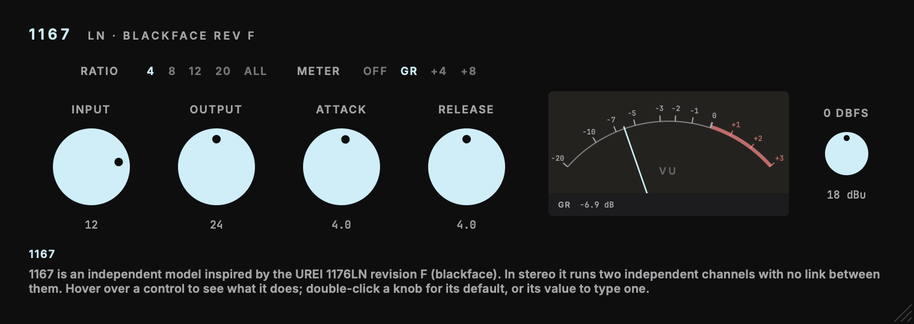

# 1167

Inspired by the UREI 1176LN, revision F.<br>
Part of our legacy collection: recreations built from schematics where available, with extremely high CPU use in the heaviest models. They're legacy now, but we still think they sound pretty great.

1167 is a schematic-derived AU and VST3 compressor model. Its signal path, side chain, gain-reduction FET, discrete line amplifier, transformers, meter behaviour, and front-panel control laws follow the documented revision F circuit. The model solves the component network rather than approximating it with a conventional compressor transfer curve. Its heaviest processing uses a large nonlinear circuit solver and can consume most of one CPU core per stereo instance, especially at higher sample rates.



1167 is an independent product identity. It keeps the original parameter IDs, order, ranges, defaults, and serialized state schema so existing 1176 automation and state data remain compatible. Its bundle identifier is `com.c0dypeng.legacy1167`.

## Downloads

Get the latest packages from the [1167 releases page](https://github.com/chijenpeng/1167/releases/latest). The macOS release contains Universal AU and VST3 bundles for Apple Silicon and Intel. The Windows release contains a native x64 VST3. macOS bundles are ad-hoc signed and are not notarized; the Windows plug-in is unsigned.

1167 has its own plug-in identity, so existing DAW instances continue to refer to the original 1176 plug-in and must be replaced manually. The parameter IDs, order, ranges, defaults, and serialized state schema are preserved for compatible host state and preset transfer.

## Controls

- **Input** and **Output** use the hardware's attenuation markings. Both at 24 are approximately unity gain below the limiting threshold.
- **Attack** and **Release** run from 1 to 7, clockwise faster. Turning Attack below 1 clicks the limiter off while leaving the audio path active.
- **Ratio** provides 4:1, 8:1, 12:1, 20:1, all-buttons-in, and no button selected.
- **Meter** switches between off, gain reduction, +4 VU, and +8 VU.
- **0 dBFS** sets the analogue calibration from 10 to 26 dBu.

Stereo processing is dual mono: each channel has its own complete circuit and side chain, with no stereo link.

## Build

The project requires CMake 3.22 or later and a C++17 compiler. For AU and VST3 builds, use macOS 11 or later; the Windows VST3 release uses native x64 MSVC from Visual Studio 2022. It uses JUCE 8.0.9. Put a local checkout at `third_party/JUCE` to avoid a fetch; otherwise CMake downloads that tagged release while configuring.

```sh
cmake -S . -B build -G Ninja -DCMAKE_BUILD_TYPE=Release
cmake --build build -j2
ctest --test-dir build --output-on-failure
```

On Windows, configure with `cmake -S . -B build -G "Visual Studio 17 2022" -A x64 -DCOPY_PLUGIN_AFTER_BUILD=OFF`, then build with `cmake --build build --config Release --parallel 2` and test with `ctest --test-dir build -C Release --output-on-failure`.

Plug-in copying is disabled by default, so builds stay in the build tree and do not touch installed plug-ins. To copy AU and VST3 bundles into the current user's Audio Plug-Ins folders, explicitly configure with `-DCOPY_PLUGIN_AFTER_BUILD=ON`. Build products remain under `build/Plugin1167_artefacts/Release`.

## Validation and snapshots

`plugin1167_test` checks operating points, factory ratio and bias tests, attack and release, distortion, frequency response, meter ballistics, sample-rate independence, real-time allocation safety, and processing speed. `plugin1167_eval` measures a rendered audio file.

The snapshot utility additionally checks plug-in parameter laws and state restoration, then renders the two maintained editor images:

```sh
cmake --build build --target plugin1167_snapshot
./build/plugin1167_snapshot_artefacts/Release/plugin1167_snapshot docs
```

The hardware circuit sources and modelling boundaries are documented in [`docs/reference/schematic.md`](docs/reference/schematic.md). Research sources, measured results, and known limitations are in [`docs/research/urei-1176.md`](docs/research/urei-1176.md).
